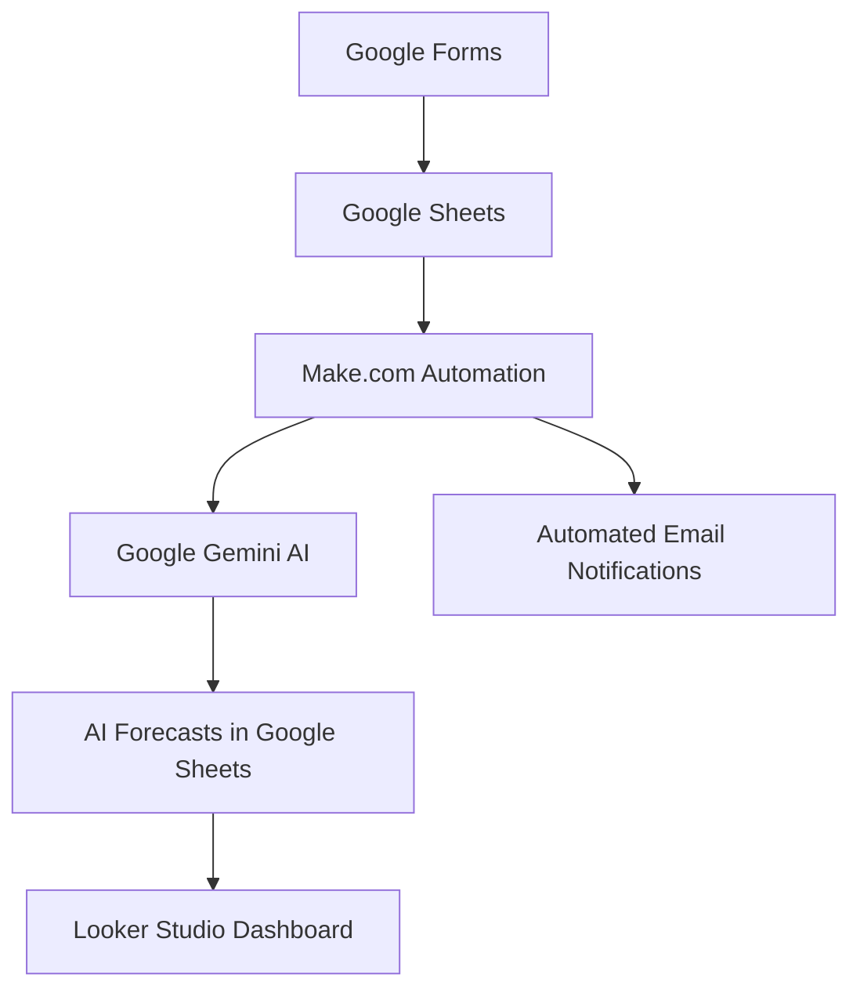

# SmartRetail – AI-Powered Inventory & Sales Management System

## Project Overview

SmartRetail is a demonstration business management solution designed to improve inventory control, automate routine business operations, and support data-driven decision-making.

The system integrates Make.com, Google Sheets, Google Gemini AI, and Looker Studio to automate inventory workflows, analyze sales activity, generate inventory forecasts, and provide management with an interactive dashboard.

## Business Problem

Retail businesses often face challenges such as:
- Manual inventory tracking and stock adjustments.
- Delayed identification of low-stock products.
- Limited visibility into sales performance.
- Difficulty estimating future product demand.
- Time-consuming communication between inventory staff and management.

SmartRetail demonstrates how business process automation and AI can help address these challenges.

## Solution

The project implements five automated workflows:

1. **Inventory Restock Automation** – Records inventory replenishment and updates product stock quantities.
2. **Inventory Low-Stock Alert Automation** – Identifies products at or below their reorder levels and sends alerts.
3. **Inventory Stock Adjustment Automation** – Processes inventory adjustment requests and validates stock availability.
4. **Inventory Stock Adjustment Response Automation** – Sends email notifications for successful and rejected adjustment requests.
5. **AI Inventory Forecasting Automation** – Uses Google Gemini AI to analyze inventory and sales information, assess stockout risk, and recommend order quantities.

## Technology Stack

| Technology | Purpose |
|---|---|
| Make.com | Workflow automation and integration |
| Google Sheets | Data storage and tracking |
| Google Forms | Inventory request input |
| Google Gemini AI | AI-powered inventory analysis |
| Looker Studio | Interactive business intelligence dashboard |

## Business Intelligence Dashboard
### Live Dashboard

### Dashboard Preview

)

[View the SmartRetail Management Dashboard](https://datastudio.google.com/reporting/c4c50f31-cfff-438e-a645-7728cf2d1108)

The Looker Studio dashboard provides management with visibility into:

- Total sales revenue.
- Total units sold.
- Number of sales.
- Revenue by product.
- Units sold by product.
- Current inventory by product.
- AI inventory forecasts and stockout risk.
- Sales revenue trends over time.

## AI Forecasting

The AI forecasting workflow analyzes product-level information, including:

- Current inventory levels.
- Reorder levels.
- Historical sales quantities.
- Average daily demand.
- Predicted demand over a seven-day forecast period.

Gemini generates risk classifications and inventory recommendations to support purchasing decisions.

## Project Architecture

Google Forms / Google Sheets → Make.com → Google Gemini AI → Google Sheets → Looker Studio

Email notifications are also generated through the automated workflows.

## Skills Demonstrated

- Business Process Automation
- Data Analytics
- AI Integration
- Workflow Design
- Data Management
- Inventory Analysis
- Demand Forecasting
- Business Intelligence
- Dashboard Development
- Process Optimization

## Project Data

This project uses simulated sales and inventory records for demonstration and educational purposes. Forecasts and recommendations should not be interpreted as actual business purchasing decisions.

## Project Status

Core automation workflows and the management dashboard have been developed and tested. Further improvements may include additional reporting, more advanced forecasting models, and expanded operational integrations.
