# SmartRetail – AI-Powered Inventory & Sales Management System

## Project Overview

SmartRetail is a demonstration business management solution designed to improve inventory control, automate routine business operations, and support data-driven decision-making.

The system integrates **AppSheet, Make.com, Google Sheets, Google Gemini AI, and Looker Studio** to provide an inventory management interface, automate inventory workflows, analyze sales activity, generate inventory forecasts, and give management access to an interactive business intelligence dashboard.

The project demonstrates how a connected business application can combine data management, workflow automation, and AI to solve practical retail operational challenges.

## Business Problem

Retail businesses often face challenges such as:

- Manual inventory tracking and stock adjustments.
- Delayed identification of low-stock products.
- Limited visibility into sales performance.
- Difficulty estimating future product demand.
- Inaccurate inventory updates and insufficient stock validation.
- Time-consuming communication between inventory staff and management.

SmartRetail demonstrates how business applications, process automation, and AI can help address these challenges.

## Solution

The project combines an AppSheet inventory management application with five core operational automation workflows and an AI-powered forecasting capability.

### Core Automation Workflows

1. **Inventory Restock Automation** – Records inventory replenishment and updates product stock quantities.
2. **Inventory Low-Stock Alert Automation** – Identifies products at or below their reorder levels and sends email alerts to management.
3. **Inventory Stock Adjustment Automation** – Processes inventory adjustment requests and validates stock availability.
4. **Inventory Stock Adjustment Response Automation** – Sends email notifications for successful and rejected adjustment requests.
5. **AppSheet Inventory Transaction Automation** – Processes restock, sale, adjustment, and return transactions submitted through AppSheet, updates product inventory, and records transaction processing results.

### AI Capability

**AI Inventory Forecasting** – Uses Google Gemini AI to analyze inventory and sales information, assess stockout risk, and generate demand forecasts and replenishment recommendations.

## AppSheet Inventory Management Application

SmartRetail includes an AppSheet application that provides an interactive interface for inventory staff to manage inventory transactions.

The application connects to the Google Sheets database and allows authorized users to submit:

- Restock transactions.
- Sales transactions.
- Inventory adjustments.
- Product returns.

### AppSheet dashboard
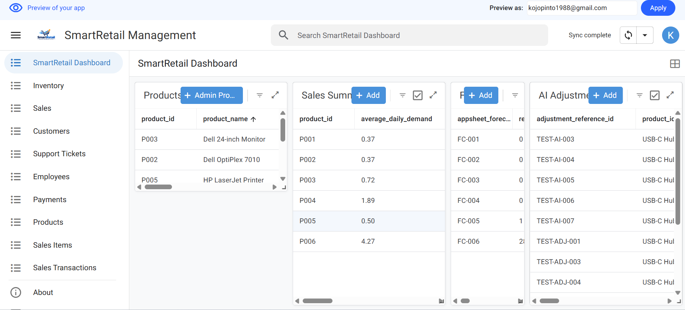

### Application Features

- **Transaction Entry:** Staff can submit inventory transactions through an AppSheet form.
- **Automatic Identification:** Transaction IDs and relevant transaction details are populated automatically.
- **Stock Visibility:** Displays the selected product's current available stock.
- **Quantity Validation:** Enforces transaction-specific quantity rules and prevents invalid stock deductions.
- **Low-Stock Warning:** Displays a warning when a product's stock reaches or falls below its reorder level.
- **Adjustment Notes:** Requires an explanation when an inventory adjustment is submitted.
- **Processing Status:** Displays transaction processing information, including Pending, Completed, and Failed statuses.
- **Role-Based Access:** Uses application user roles to control access to inventory functions.

### Inventory Transaction Form Dashboard Preview

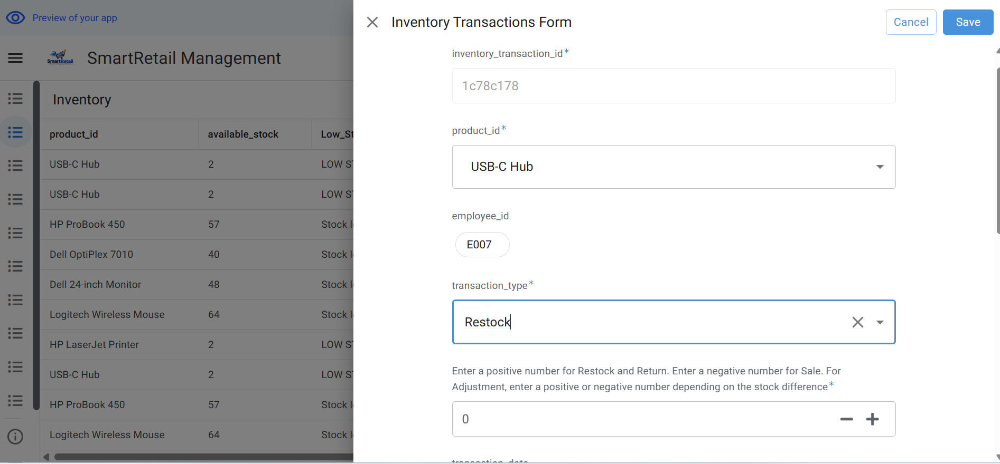

### Transaction Processing

When a user submits a transaction through AppSheet:

1. The transaction is recorded in the Google Sheets `Inventory_Transactions` table.
2. Make.com detects the new transaction.
3. The automation identifies the transaction type and retrieves the corresponding product record.
4. Stock validation and transaction-specific processing rules are applied.
5. The product inventory is updated when the transaction is valid.
6. The transaction record is updated with its processing status and message.
7. Duplicate transactions and invalid requests are handled to prevent unintended inventory changes.

This integration provides a traceable process for managing inventory movements.

## Key Features

- **Automated Inventory Restocking:** Updates stock records when inventory is replenished.
- **Low-Stock Monitoring:** Detects products that reach their reorder levels and triggers email alerts.
- **Inventory Transaction Management:** Processes restock, sale, adjustment, and return transactions through AppSheet.
- **Inventory Adjustment Validation:** Checks adjustment requests and prevents invalid stock deductions.
- **Transaction Tracking:** Records transaction status, processing messages, and timestamps.
- **Duplicate Transaction Protection:** Prevents previously processed transactions from being applied again.
- **Automated Email Notifications:** Notifies management about low-stock conditions and relevant inventory processing outcomes.
- **AI-Powered Forecasting:** Uses Google Gemini AI to assess stockout risk and recommend replenishment quantities.
- **Interactive Management Dashboard:** Visualizes revenue, sales volume, inventory levels, and AI-generated forecasts using Looker Studio.

## Technology Stack

| Technology | Purpose |
|---|---|
| AppSheet | Inventory management application and transaction entry interface |
| Make.com | Workflow automation and system integration |
| Google Sheets | Central data storage and transaction tracking |
| Google Forms | Input for selected inventory workflows |
| Google Gemini AI | AI-powered inventory analysis and forecasting |
| Looker Studio | Interactive business intelligence dashboard |

## Business Intelligence Dashboard

### Live Dashboard

### Dashboard Preview

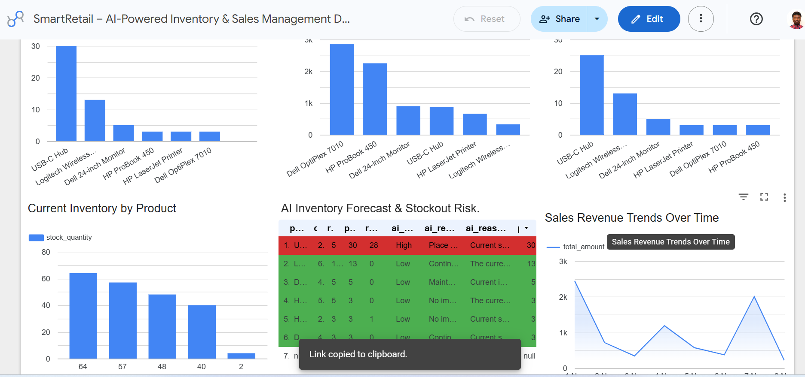

[View the SmartRetail Management Dashboard](https://datastudio.google.com/reporting/c4c50f31-cfff-438e-a645-7728cf2d1108)

The Looker Studio dashboard provides management with visibility into:

- Total sales revenue.
- Total units sold.
- Number of sales.
- Revenue by product.
- Units sold by product.
- Current inventory by product.
- AI inventory forecasts and stockout risk.
- Sales revenue trends over time.

## AI Forecasting

The AI forecasting workflow uses Google Gemini AI to analyze product-level information, including:

- Current inventory levels.
- Reorder levels.
- Historical sales quantities.
- Average daily demand.
- Predicted demand over a seven-day forecast period.

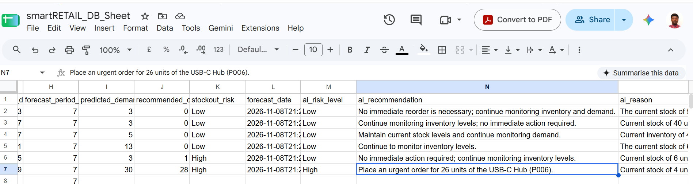

Gemini generates risk classifications and inventory recommendations to support purchasing and inventory planning decisions.

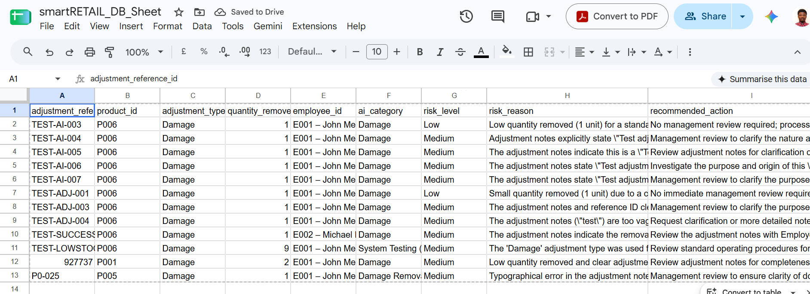

## Project Architecture

SmartRetail uses a connected architecture in which AppSheet provides the inventory interface, Google Sheets stores operational data, and Make.com handles business process automation and AI integration.

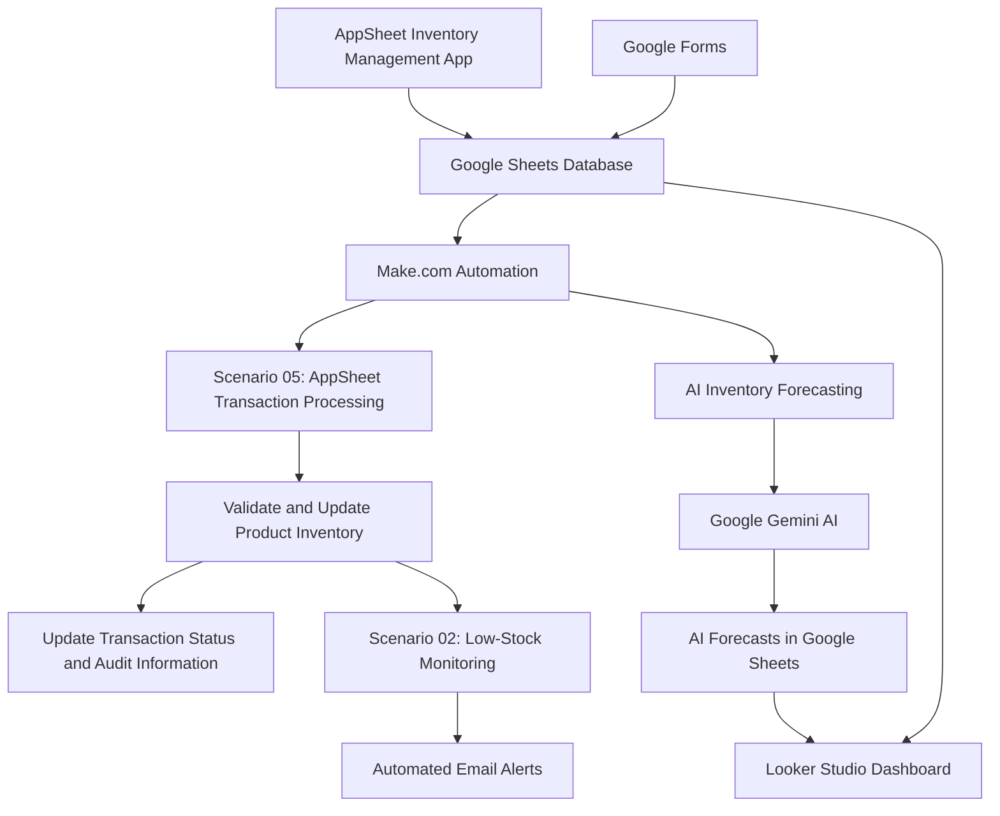

## Make.com Automation Workflows

SmartRetail uses five Make.com scenarios to automate inventory operations and transaction processing.

### Scenario 01 – Inventory Restock Automation

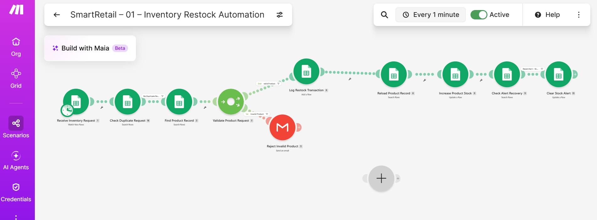

### Scenario 02 – Inventory Low-Stock Alert Automation

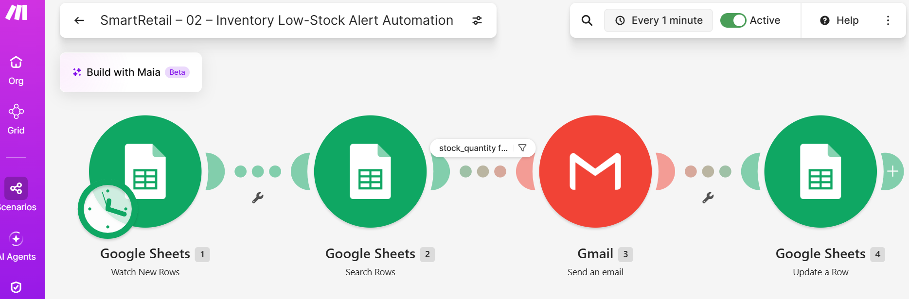

### Scenario 03 – Inventory Stock Adjustment Automation

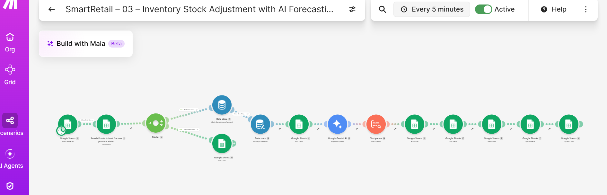

### Scenario 04 – Inventory Stock Adjustment Response Automation

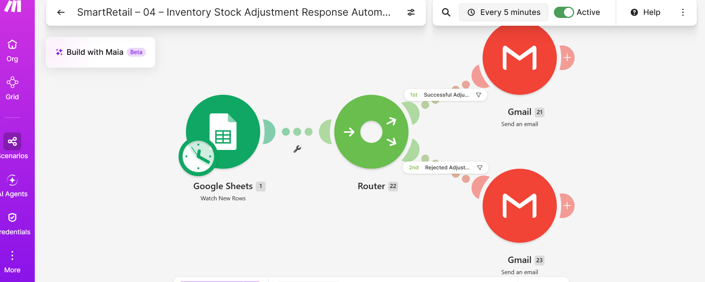

### Scenario 05 – AppSheet Inventory Transaction Automation

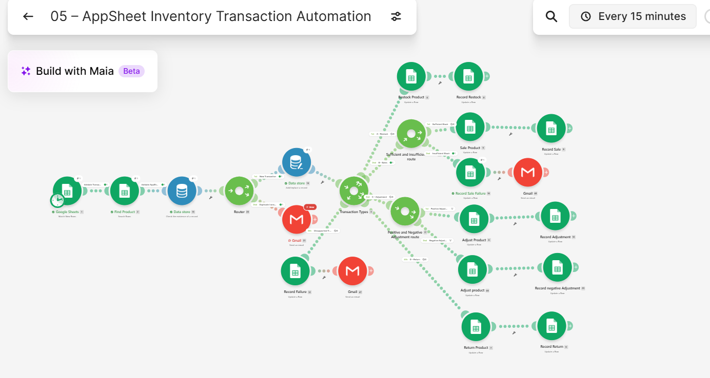

### Architecture Overview

- **AppSheet:** Provides the user-facing inventory management application.
- **Google Sheets:** Serves as the central data source for products, inventory transactions, and related business records.
- **Make.com:** Coordinates transaction processing, inventory updates, validation, notifications, and AI workflows.
- **Google Gemini AI:** Analyzes inventory and sales information to generate forecasts and recommendations.
- **Looker Studio:** Presents business performance information through an interactive management dashboard.

The AppSheet transaction workflow updates inventory records, while the low-stock monitoring workflow evaluates inventory levels and sends alerts when required.

## Skills Demonstrated

- Business Application Development
- Business Process Automation
- Data Analytics
- AI Integration
- Workflow Design
- AppSheet Application Development
- Google Sheets Data Management
- API and System Integration Concepts
- Inventory Management
- Demand Forecasting
- Business Intelligence
- Dashboard Development
- Data Validation and Quality Control
- Process Optimization

## Project Data

This project uses simulated sales and inventory records for demonstration and educational purposes. Forecasts and recommendations should not be interpreted as actual business purchasing decisions.

## Future Enhancements

- Integrate live sales and inventory data from a real retail environment.
- Improve demand forecasting using historical sales patterns and machine learning.
- Expand role-based permissions and approval workflows.
- Introduce additional inventory and sales performance reports.
- Integrate external inventory or accounting systems through APIs.
- Expand the application to support additional retail business operations.

## Project Status

The core SmartRetail application and automation workflows have been developed and tested.

Current capabilities include:

- AppSheet inventory transaction management.
- Google Sheets database integration.
- Make.com inventory transaction processing.
- Stock validation and duplicate transaction protection.
- Low-stock monitoring and email notifications.
- AI-powered inventory forecasting.
- Looker Studio management dashboard.

Further improvements may include additional reporting, more advanced forecasting models, and expanded operational integrations.

## Project Demo

### Live Dashboard

Explore the interactive SmartRetail management dashboard:

[Open SmartRetail Dashboard](https://datastudio.google.com/reporting/c4c50f31-cfff-438e-a645-7728cf2d1108)

**Note:** SmartRetail is a demonstration project built with simulated business data. The dashboard and automation workflows illustrate how AI and business process automation can support retail operations.

## Project Documentation

The following documents provide additional details about the SmartRetail project:

1. [AppSheet Integration Documentation](SmartRetail_AppSheet_Integration_Documentation.md) – Explains the inventory application, transaction validation, stock updates, and Make.com integration.

2. [Lessons Learned and Development Process](SmartRetail_Lessons_Learned_and_Development_Process.md) – Documents the development journey, technical challenges, solutions, and lessons learned.

3. [SmartRetail Portfolio Case Study](SmartRetail_Portfolio_Case_Study.md) – Explains the business problem, solution, architecture, implemented features, technical challenges, and skills demonstrated.

3. [SmartRetail Portfolio Case Study](SmartRetail_Portfolio_Case_Study.md) – Explains the business problem, solution, architecture, implemented features, technical challenges, and skills demonstrated.

## About the Developer

Developed as a hands-on portfolio project to demonstrate practical skills in data analytics, business intelligence, AI integration, and business process automation.

The project reflects an interest in building technology solutions that help businesses automate operations, improve data visibility, and make informed decisions.

**Developer:** Solomon Pinto

**GitHub:** [KOJOPINTO](https://github.com/KOJOPINTO)
